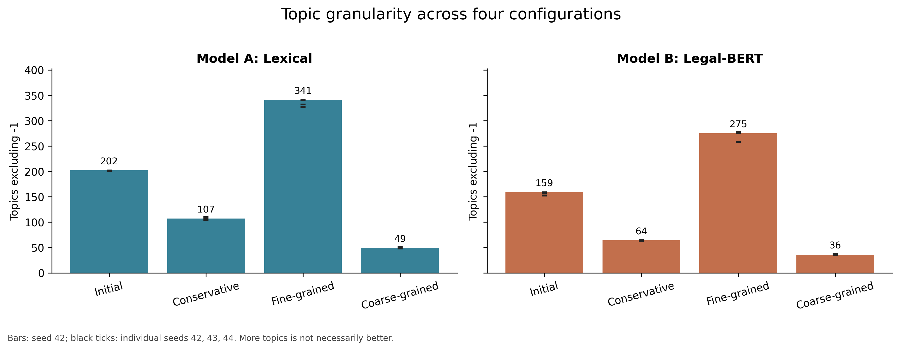
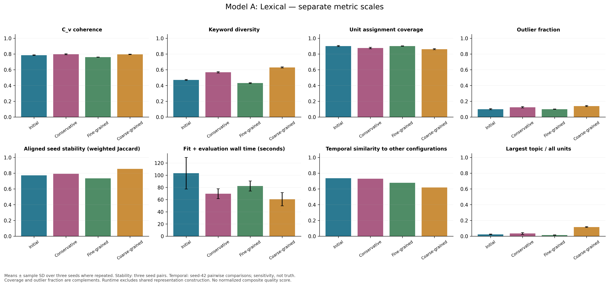
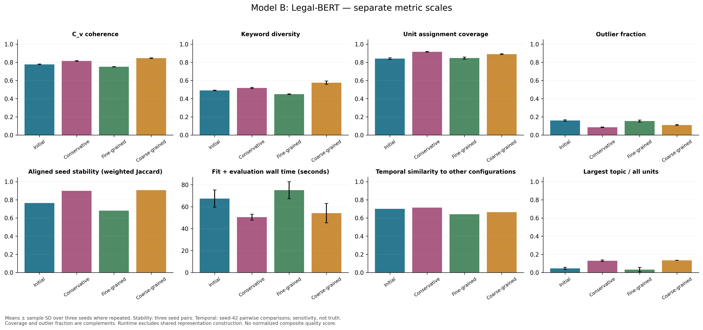
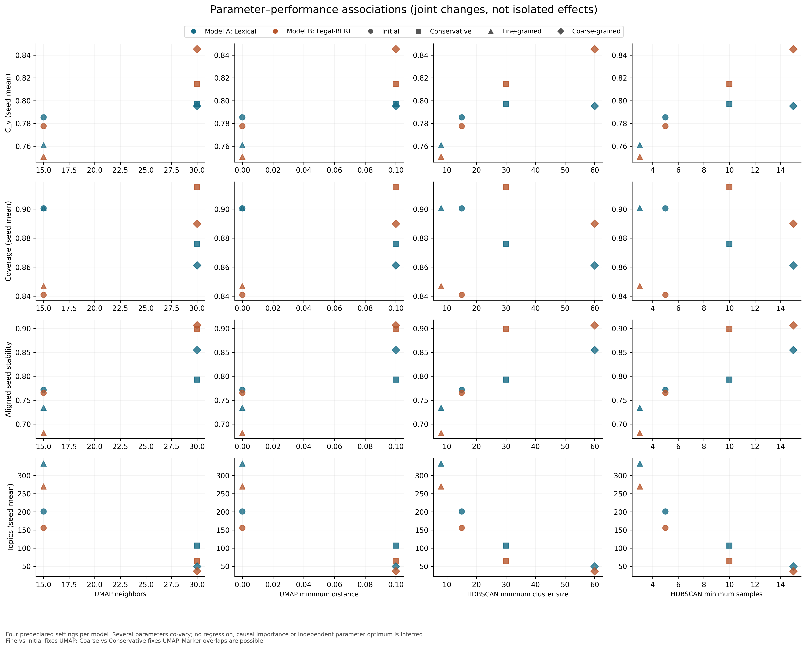
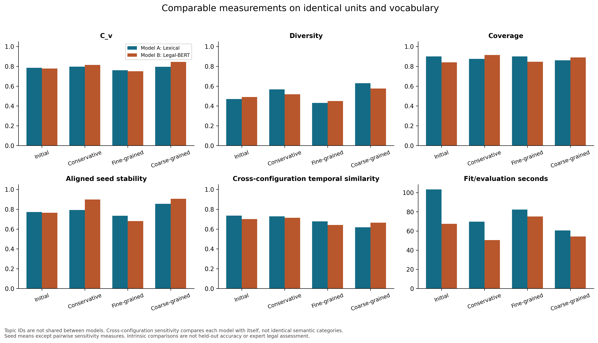
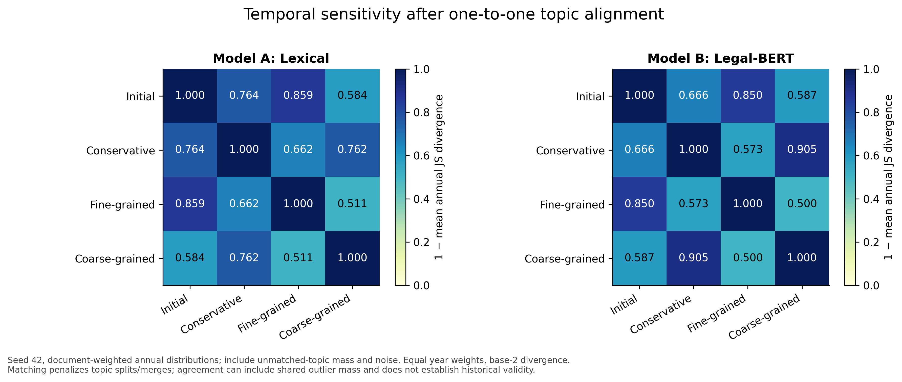
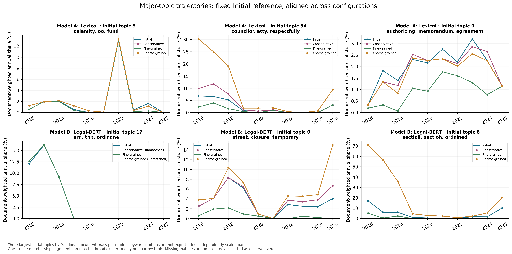

# Four-configuration tuning — completed measured results

Generated 2026-10-23T04:25:53.768673+00:00. **24/24 full fits completed:**
four configurations × two models × seeds 42, 43, 44. All 7,832 eligible units from
2,118 source documents, 2016–2025; no sample or fabricated results. Source hash:
`2d415dfbc71838d02349ce1ebb26783dd58cbd7f9ab683b18bc1a989d5471b16`.

## Configurations

| name | neighbors | min_dist | min_cluster_size | min_samples | purpose |
| --- | --- | --- | --- | --- | --- |
| initial | 15 | 0.0000 | 15 | 5 | Unchanged original Initial baseline. |
| conservative | 30 | 0.1000 | 30 | 10 | Unchanged original Conservative baseline; smoother neighborhood and larger, denser clusters. |
| fine_grained | 15 | 0.0000 | 8 | 3 | Keep Initial UMAP fixed; relax HDBSCAN size and density requirements to test smaller/local policy clusters and fragmentation. |
| coarse_grained | 30 | 0.1000 | 60 | 15 | Keep Conservative UMAP fixed; require larger and denser HDBSCAN clusters to test broad themes, merging, and exclusion of rare subjects. |

## Primary seed 42 results

| model | trial | topics_excluding_outliers | cv_coherence | topic_diversity | assigned_units | outlier_sections | topic_coverage | outlier_fraction |
| --- | --- | --- | --- | --- | --- | --- | --- | --- |
| lexical | initial | 202 | 0.7882 | 0.4694 | 7088 | 744 | 0.9050 | 0.0950 |
| semantic | initial | 159 | 0.7813 | 0.4919 | 6509 | 1323 | 0.8311 | 0.1689 |
| lexical | conservative | 107 | 0.7960 | 0.5689 | 6794 | 1038 | 0.8675 | 0.1325 |
| semantic | conservative | 64 | 0.8171 | 0.5120 | 7162 | 670 | 0.9145 | 0.0855 |
| lexical | fine_grained | 341 | 0.7592 | 0.4333 | 7069 | 763 | 0.9026 | 0.0974 |
| semantic | fine_grained | 275 | 0.7534 | 0.4514 | 6611 | 1221 | 0.8441 | 0.1559 |
| lexical | coarse_grained | 49 | 0.7927 | 0.6289 | 6727 | 1105 | 0.8589 | 0.1411 |
| semantic | coarse_grained | 36 | 0.8433 | 0.5718 | 7004 | 828 | 0.8943 | 0.1057 |

## Stability, temporal sensitivity and computational cost

| model | trial | stability_ari_mean | seed_aligned_macro_jaccard_mean | seed_aligned_weighted_jaccard_mean | cross_config_temporal_similarity_mean | fit_evaluation_seconds_mean | sampled_peak_rss_mib_mean |
| --- | --- | --- | --- | --- | --- | --- | --- |
| lexical | initial | 0.5305 | 0.7706 | 0.7718 | 0.7354 | 103.2833 | 655.2826 |
| semantic | initial | 0.5737 | 0.7578 | 0.7653 | 0.7007 | 67.4221 | 613.8945 |
| lexical | conservative | 0.6110 | 0.7968 | 0.7929 | 0.7291 | 69.6636 | 608.3385 |
| semantic | conservative | 0.8559 | 0.8716 | 0.8992 | 0.7145 | 50.4542 | 627.1172 |
| lexical | fine_grained | 0.3918 | 0.7302 | 0.7341 | 0.6772 | 82.3256 | 646.0716 |
| semantic | fine_grained | 0.3829 | 0.6794 | 0.6814 | 0.6409 | 75.0686 | 662.0312 |
| lexical | coarse_grained | 0.7306 | 0.8170 | 0.8548 | 0.6187 | 60.6131 | 658.3867 |
| semantic | coarse_grained | 0.8850 | 0.8672 | 0.9064 | 0.6640 | 54.1812 | 656.7865 |

Original `stability_ari_mean` compares seed 42 to 43/44 with noise as a cluster.
Aligned scores use all three pairs and penalize unmatched topics. Temporal
similarity is 1 minus mean annual base-2 JS divergence to the other configurations,
not agreement with ground truth. Runtime means are single-seed fit/evaluation,
excluding shared representation construction; memory is sampled whole-process RSS.

## Seed sensitivity (not confidence intervals)

| model | trial | topics_excluding_outliers (mean ± SD) | cv_coherence (mean ± SD) | topic_diversity (mean ± SD) | topic_coverage (mean ± SD) | fit_evaluation_seconds (mean ± SD) |
| --- | --- | --- | --- | --- | --- | --- |
| lexical | initial | 201.3333 ± 1.1547 | 0.7853 ± 0.0033 | 0.4703 ± 0.0063 | 0.9005 ± 0.0070 | 103.2833 ± 25.8780 |
| semantic | initial | 155.6667 ± 3.5119 | 0.7776 ± 0.0044 | 0.4903 ± 0.0031 | 0.8409 ± 0.0085 | 67.4221 ± 7.8251 |
| lexical | conservative | 107.0000 ± 3.0000 | 0.7970 ± 0.0058 | 0.5677 ± 0.0085 | 0.8760 ± 0.0089 | 69.6636 ± 8.0714 |
| semantic | conservative | 64.0000 ± 1.0000 | 0.8147 ± 0.0035 | 0.5182 ± 0.0056 | 0.9151 ± 0.0029 | 50.4542 ± 2.7153 |
| lexical | fine_grained | 333.3333 ± 7.0946 | 0.7608 ± 0.0014 | 0.4305 ± 0.0055 | 0.9006 ± 0.0024 | 82.3256 ± 8.2679 |
| semantic | fine_grained | 270.3333 ± 10.7858 | 0.7507 ± 0.0026 | 0.4491 ± 0.0035 | 0.8469 ± 0.0116 | 75.0686 ± 7.7692 |
| lexical | coarse_grained | 49.3333 ± 1.5275 | 0.7953 ± 0.0031 | 0.6295 ± 0.0067 | 0.8612 ± 0.0067 | 60.6131 ± 10.7928 |
| semantic | coarse_grained | 36.3333 ± 1.5275 | 0.8454 ± 0.0034 | 0.5759 ± 0.0184 | 0.8899 ± 0.0048 | 54.1812 ± 8.8436 |

## Pairwise temporal comparisons

| model | left_trial | right_trial | temporal_similarity | temporal_tv_mean | matched_intersection_fraction | unmatched_left_topics | unmatched_right_topics |
| --- | --- | --- | --- | --- | --- | --- | --- |
| lexical | initial | conservative | 0.7637 | 0.3436 | 0.5732 | 95 | 0 |
| lexical | initial | fine_grained | 0.8589 | 0.2017 | 0.7070 | 0 | 139 |
| lexical | initial | coarse_grained | 0.5837 | 0.5640 | 0.3404 | 153 | 0 |
| lexical | conservative | fine_grained | 0.6619 | 0.4638 | 0.4428 | 0 | 234 |
| lexical | conservative | coarse_grained | 0.7618 | 0.3237 | 0.5393 | 58 | 0 |
| lexical | fine_grained | coarse_grained | 0.5107 | 0.6367 | 0.2666 | 292 | 0 |
| semantic | initial | conservative | 0.6655 | 0.4734 | 0.4630 | 95 | 0 |
| semantic | initial | fine_grained | 0.8497 | 0.2114 | 0.6525 | 0 | 116 |
| semantic | initial | coarse_grained | 0.5868 | 0.5580 | 0.3401 | 123 | 0 |
| semantic | conservative | fine_grained | 0.5728 | 0.5768 | 0.3561 | 0 | 211 |
| semantic | conservative | coarse_grained | 0.9051 | 0.1490 | 0.7524 | 28 | 0 |
| semantic | fine_grained | coarse_grained | 0.5003 | 0.6466 | 0.2550 | 239 | 0 |

## Figures

[All seven figures as a vector PDF](Tuning_Comparison_Figures.pdf).

## Reproducibility and limitations

- Full model outputs, code snapshots, configuration, environment and artifact hashes:
  `results/experiments/four_configuration_tuning/`.
- Compact evidence and source-linked review templates: `evidence/`.
- All figures: 300-dpi PNG plus vector PDF/SVG in `figures/`.
- Shared lexical representation wall time: 4.515 seconds.
- Semantic cache/load or encoding wall time: 25.349 seconds;
  encoder cache used: **True**.
- Original cached encoder session time: 571.411 seconds;
  this is historical provenance, **not fresh GPU encoding in these reruns**.
- Current complete session wall time: 1752.646 seconds.
- The first lexical fit includes one-time import/Numba JIT overhead; fixed-order
  warmed timings are not an isolated algorithm-speed benchmark.
- SVD and Legal-BERT representations are fixed across seeds; seed stability concerns
  downstream clustering. Joint parameter changes do not isolate causal effects.
- C_v/diversity are intrinsic keyword diagnostics. Coverage and noise are complements.
  Different topic counts, noise and dominant clusters affect comparisons.
- The 597 fallback documents, 45 additional same-number text variants and 28 date
  flags remain part of the original audited methodology, not newly validated issues.
- Legal-expert ratings remain blank. Keyword examples and provisional recommendations
  must not be described as expert validation, predictive accuracy or causation.

See `docs/FOUR_CONFIGURATION_METHODS.md` for formulas and exact reproduction commands.
Research interpretation, provisional selection and a thesis-ready results section
are available in [the completed findings](../../docs/FOUR_CONFIGURATION_FINDINGS.md).
That section is written only after checking the completed experiments. The original
reference thesis PDF is not overwritten.
